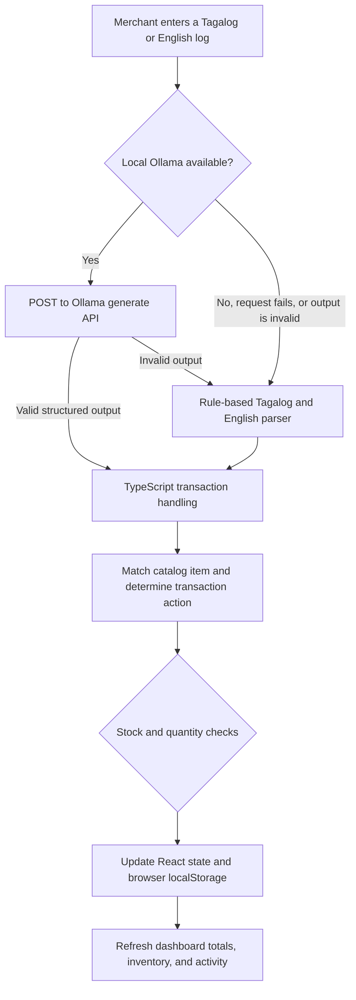

# SariSmart

**A local-first inventory logging prototype for sari-sari stores.**

SariSmart is a browser-based dashboard for recording store activity in everyday Tagalog, Taglish, or English. A merchant can enter a short log such as “Nakabenta ako ng 3 pancit canton” or “Nagdagdag ng 8 Red Horse.” The app uses a local Ollama model to extract transaction details and falls back to a rule-based parser when Ollama is unavailable or returns unusable output. TypeScript then applies the transaction to the inventory held in the browser.

SariSmart is an early v0.1 prototype, not a production point-of-sale system. It does not calculate profit, synchronize data across devices, or guarantee that the app itself can be loaded without an internet connection.

## Why SariSmart?

Small neighborhood stores often track stock and sales in paper notebooks. Conventional inventory tools can require many forms and manual selections for routine transactions. SariSmart explores a simpler interaction: write what happened in a single text box and review the resulting inventory change.

## How a log is processed



### Responsibilities and guardrails

- **Ollama is the primary extraction service.** The browser sends a request to `http://localhost:11434/api/generate` using `qwen2.5:1.5b`. The model is prompted to return item name, action, quantity, and price fields. Its response is parsed and validated before use.
- **TypeScript applies the transaction.** The app infers the final action from the original log, matches product names and aliases, uses catalog prices where available, checks sales against available stock, and updates the client-side state.
- **The fallback is rule-based.** If Ollama cannot be reached or its response cannot be used, a local parser looks for supported product names, quantities, and transaction keywords.
- **Browser storage is the persistence layer.** Inventory and recent activity are saved in `localStorage` for the current browser origin. There is no server-side database or cross-device synchronization.

The LLM is not the business-logic or accounting engine. However, the current implementation still asks the model to return an action and a price field as part of its extraction response; this is an implementation detail of v0.1 rather than a claim that the model only extracts product and quantity.

## Current features

- Dashboard summaries for logged sales, inventory value, low-stock products, and today's activity count.
- Natural-language sale and restock logging in Tagalog, Taglish, or English.
- Local Ollama extraction with automatic rule-based fallback.
- Product catalog matching and aliases for the seeded inventory.
- Inventory search, low-stock indicators, and a quick-restock control.
- Browser-local persistence of inventory and recent activity.
- A local Ollama availability indicator. While the configured model is unavailable, the app checks Ollama's `/api/tags` endpoint at the configured interval. Polling stops when the model is detected and resumes after a failed log request.

## Technology

- React 19 and TypeScript
- Vite 8
- Tailwind CSS 4 integration and project CSS styles
- Ollama with the `qwen2.5:1.5b` model
- React state and browser `localStorage`

## Project structure

```text
src/
├── components/       # Header, log input, summary cards, inventory table
├── config/           # App-level settings, including Ollama health polling
├── data/             # Seed/mock inventory data
├── services/         # Ollama API, response validation, and parser fallback
├── types/            # Inventory, activity, and parsing domain types
├── App.tsx           # Dashboard composition and local state orchestration
└── main.tsx          # React application entry point
```

## Getting started

### Requirements

- Node.js `^20.19.0` or `>=22.12.0` (required by the installed Vite 8 release)
- npm
- Ollama installed and the `qwen2.5:1.5b` model downloaded

### Install and run the dashboard

```bash
git clone https://github.com/supremeking23/SariSmart.git
cd SariSmart
npm install
npm run dev
```

Open the local URL printed by Vite in your browser.

### Set up local Ollama

Install Ollama, make sure its service is running, then download the model used by the app:

```bash
ollama pull qwen2.5:1.5b
```

The browser must be able to reach `http://localhost:11434`. You can check that the API responds by opening `http://localhost:11434/api/tags` in a browser. The response should include `qwen2.5:1.5b`. Ollama is required for the intended AI-powered workflow; if it is temporarily offline or returns invalid output, the app uses its local rule-based parser for that log.

Because the frontend calls Ollama directly, Ollama must allow requests from the frontend's browser origin. If using a hosted frontend, configure Ollama's allowed origins for that deployment origin as well. A hosted app's `localhost` refers to the device running the visitor's browser; it does not refer to the Netlify or other hosting server.

### Build and lint

```bash
npm run build
npm run lint
```

The production build is written to `dist/`. The project does not currently define a test script.

## Deploy to GitHub Pages

The repository includes a GitHub Actions workflow that builds the Vite app and publishes `dist/` to GitHub Pages whenever changes are pushed to `main`. It also supports a manual run from the Actions tab. Vite automatically uses the repository subpath for project Pages sites and the root path for `owner.github.io` sites; local development continues to use `/`.

After creating the GitHub repository:

1. Push the project to the repository's `main` branch.
2. In GitHub, open **Settings → Pages** and set **Build and deployment → Source** to **GitHub Actions**.
3. Open the **Actions** tab and wait for the **Deploy to GitHub Pages** workflow to complete successfully.
4. Open the Pages URL shown in **Settings → Pages**. For a project site, it is usually `https://OWNER.github.io/REPOSITORY/`.

The hosted page serves the frontend only. Ollama is not hosted by GitHub Pages: AI parsing requires a compatible Ollama service and the `qwen2.5:1.5b` model on the visitor's own device, configured to allow requests from the Pages origin. If the browser cannot reach Ollama, the local rule-based parser is used as a fallback. Inventory and activity data remain local to each visitor's browser.

## Current limitations

These are important v0.1 behaviors, not guarantees or planned features:

1. **One transaction action per log.** The action is inferred for the whole log. A mixed sentence such as “Restock 10 canton and sold 2 Coke” is not reliably handled; submit separate sale and restock logs.
2. **Parser defaults and unknown products.** The rule-based parser can default an omitted quantity to `1`. If it cannot match a product, it can produce a generic item with a fallback price. Review the parsed result and inventory after logging, especially for unfamiliar wording or products.
3. **Catalog and aliases are finite.** Matching and default prices are based on the app's seeded product catalog and parser aliases. New inventory entries and parser aliases are separate concerns in the current implementation; adding an item to inventory does not automatically teach the fallback parser every possible product spelling.
4. **Multi-item logs may partially apply.** Valid items can be recorded while a sale that fails stock validation is rejected. Review the displayed result and error message for each log.
5. **Sales are not profit.** “Sales Today” is gross sales value calculated from successful sale activity. The app does not track supplier costs, expenses, margins, or profit. Inventory value also uses the app's product prices, not a separate cost basis.
6. **Storage is per browser and origin.** Clearing browser storage or using another browser/device does not preserve or synchronize the data. Recent activity is capped at 100 records.
7. **Quick restock is not logged as an activity.** The inventory table's quick-restock button changes stock directly; natural-language restock logs create activity records.
8. **Ollama runs on the client device.** There is no backend proxy. A deployed frontend can use Ollama only if a local Ollama service is running on the visitor's device and allows the page's origin.
9. **No guaranteed app-shell offline mode.** The rule parser can process logs without Ollama after the app has loaded, but the project does not include a service worker/PWA cache to guarantee loading the application without a network connection.
10. **Dashboard scope is limited.** Inventory and dashboard workflows are implemented; the navigation also shows Transactions and Store settings labels, but those are not complete dedicated sections yet. The app accepts typed logs; voice input and receipt scanning are not implemented.

## Roadmap

Potential follow-up work beyond v0.1:

- Move catalog rules, stock validation, and transaction processing behind a backend API.
- Add stronger transaction confirmation and handling for multiple actions in one log.
- Make the product catalog and parser aliases share one source of truth.
- Add cost tracking, expense entry, and accurate profit reporting.
- Add database-backed backup and multi-device synchronization.
- Add a deliberate offline app-shell strategy, such as a tested service worker/PWA.
- Explore receipt or logbook capture with OCR, and voice input.
- Evaluate optional cloud-model routing while keeping local processing as an option.

## License

No license is currently specified in this repository. Contact the maintainers before redistributing or using the project beyond the permissions granted by the repository owner.
